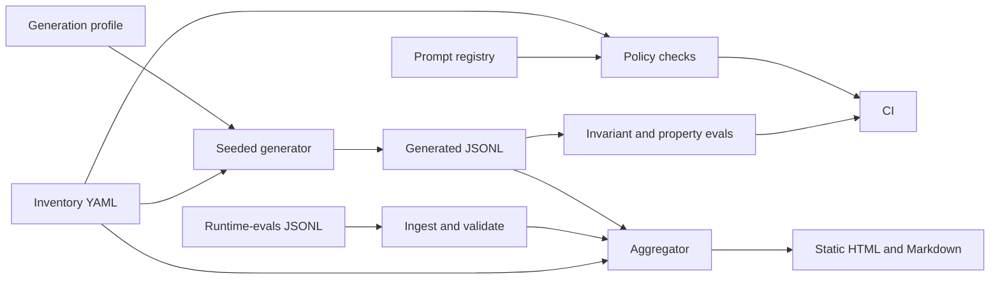

# agent-governance-cost-board

## Start here

It proves a local policy gate on a simulated fleet of 12 agents: the fleet file passes, a violating inventory fails, invariant evals pass, and a forced regression fails. The cost board is a simulated example, not a measured saving.

One command, after `python3 -m pip install -e ".[dev]"`: `python3 -m governance_board demo`.

Walkthrough: [docs/HOW_IT_WORKS.md](docs/HOW_IT_WORKS.md). Value plan: [docs/BUSINESS_VALUE.md](docs/BUSINESS_VALUE.md).

Policy checks, invariant evals, and a static cost board for a **simulated** fleet of 12 agents at the fictional Harborline Cooperative. The suite tests inventory rules, effect gates, and budget math. It does not test answer quality, and it does not call a model vendor.

## Problem

A fleet is hard to govern when ownership, human gates, and spend caps live in slides. This repo keeps them in YAML and checks them in CI. The static board renders either a seeded generator file or an ingested JSONL file, and the header says which one.

The board demonstrates the mechanism: policy-as-code, budget caps, a kill switch, and prompt rollback. It does not report a spend finding. The `refund-advisor` day over its cap is planted by `spike.token_multiplier` in `traces/generation.yaml`. Every figure from that generator is a **SIMULATED / illustrative example**.

Recorded on 2026-10-17, and run again on 2026-10-22 (package 0.1.0, Python 3.12.3, `--today 2026-10-17`): the fleet policy exits **0** with **zero violations**. The numbers for that re-run are in [Proof](#proof).

```bash
python3 -m governance_board policy \
  --inventory inventory/fleet.yaml \
  --prompts prompts/registry.yaml \
  --today 2026-10-17
```

## Architecture



Inventory and prompts are the source of truth. The generator is a stand-in for a runtime, and its spike is planted in the profile. Ingest reads a runtime-evals JSONL file when `--source ingested-runtime-evals` is set. The aggregator only reads events. The HTML file embeds its CSS and SVG and does not load a CDN. The header names the source. See [docs/architecture.md](docs/architecture.md) and [docs/TRACE_INGEST.md](docs/TRACE_INGEST.md).

## Quickstart

From the repo root. Cost of the demo: **zero**. No network. No API key. `make demo` is the same command as the last line.

```bash
python3 -m pip install -e ".[dev]"
python3 -m governance_board demo
```

That checks the fleet policy, writes seeded traces, and opens a static board under `demo-out/`.

`make` targets, and the same steps without make:

| Make | Plain command |
| --- | --- |
| `make setup` | `python3 -m pip install -e ".[dev]"` |
| `make lint` | `python3 -m ruff check . && python3 -m ruff format --check . && python3 -m mypy` |
| `make test` | `python3 -m pytest` |
| `make policy` | `python3 -m governance_board policy --inventory inventory/fleet.yaml --prompts prompts/registry.yaml --today 2026-10-17` |
| `make eval` | `python3 -m governance_board eval` |
| `make eval-regression` | `python3 -m governance_board eval-regression` (this **exits non-zero** on purpose) |
| `make generate` | `python3 -m governance_board generate-traces --inventory inventory/fleet.yaml --profile traces/generation.yaml --out traces/fleet.jsonl` |
| `make report` | `python3 -m governance_board report --inventory inventory/fleet.yaml --traces traces/fleet.jsonl --out docs/example-board --generated-on 2026-10-17 --source simulated-generator` |
| `make demo` | `python3 -m governance_board demo` |
| `make secretscan` | `python3 -m governance_board secretscan` |
| `make secretscan-hash` | recomputes the sha256 of `src/governance_board/secretscan.py` and checks `docs/PROVENANCE.md` |

Ingest a file in the runtime-evals shape (the sample is hand-written):

```bash
python3 -m governance_board report \
  --inventory inventory/fleet.yaml \
  --traces traces/samples/runtime_evals_sample.jsonl \
  --out demo-out/ingested-board \
  --generated-on 2026-10-17 \
  --source ingested-runtime-evals
```

The violating inventory must fail:

```bash
python3 -m governance_board policy \
  --inventory inventory/violating.yaml \
  --prompts prompts/registry.yaml \
  --today 2026-10-17
```

`Dockerfile` is in the repo. It was **not built in the authoring environment** (`docker` was not available). This text does not claim an image build.

CI runs lint, mypy, pytest (coverage floor 80%), the secret scan, the fleet policy, the violating-inventory failure, the eval gate, and the forced eval regression. See `.github/workflows/ci.yml`.

## Results

### Command results

Recorded 2026-10-17, package 0.1.0, Python 3.12.3. The same commands were run again on 2026-10-22 and printed the same exits. See [Proof](#proof).

| Command | Result |
| --- | --- |
| `python3 -m governance_board policy` on `inventory/fleet.yaml`, `--today 2026-10-17` | exit 0, zero violations |
| same command on `inventory/violating.yaml` | exit 1, five violations |
| `python3 -m governance_board eval` | exit 0; 3 YAML cases and 32 property trials, zero breaches |
| `python3 -m governance_board eval-regression` | exit 1; three breaches on one bad event (expected) |
| `python3 -m pytest` (pytest 9.1.1, Python 3.12.3, 2026-10-17) | 29 passed, total coverage 90.09% |

Property trials use seed `20261017`. The eval command's property-trial field prints 32. That is the per-property count. Four properties each use it: a cap breach is flagged, an engaged kill switch blocks, rollback restores the previous prompt version, and an agent with no owner or no risk tier fails policy.

### Illustrative board (simulated)

**SIMULATED / illustrative example**, not a measurement. Window 2026-10-04 through 2026-10-17, seed `20261017`, 12 runs per agent per day, 2016 events. The `refund-advisor` spike and the `bulletin-draft` latency are planted in `traces/generation.yaml`. Latency values are the simulated `latency_ms` field. Percentiles use linear interpolation. The p95 column is the previously published 1-decimal rounding of `docs/example-board/summary.json`. Unrounded fields stay in that file. Totals are exact integers in micro-USD from that file. The rate card is 5 and 15 micro-USD per token [EST], not a vendor price. This file was not regenerated on 2026-10-22.

| Agent | Runs | Cost total (micro-USD) | Latency p95 (ms) | Alerts |
| --- | ---: | ---: | ---: | --- |
| intake-triage | 168 | 1,814,505 | 919.9 | — |
| claim-draft | 168 | 4,286,595 | 1,465.2 | — |
| kb-search | 168 | 1,306,175 | 670.8 | — |
| invoice-extract | 168 | 2,461,840 | 1,076.9 | — |
| meeting-notes | 168 | 2,500,185 | 1,278.2 | — |
| change-review | 168 | 2,586,270 | 1,238.3 | — |
| vendor-screener | 168 | 3,225,035 | 1,500.1 | — |
| onboarding-coach | 168 | 1,310,695 | 710.5 | — |
| refund-advisor | 168 | 8,436,435 | 1,761.2 | per-run cap, per-day cap |
| bulletin-draft | 168 | 4,437,160 | 5,895.4 | p95 latency SLO |
| shift-suggester | 168 | 1,653,445 | 961.2 | — |
| safety-checklist | 168 | 833,315 | 553.3 | — |

Illustrative fleet total: **34,851,655 micro-USD** ($34.8517 at the simulated rate) across 14 days. Three alerts on this file: per-run cap, per-day cap, and a p95 latency SLO. That is the mechanism on display. It is not an observed incident.

## Use cases, governance and business strategy

### Client-style use cases

Fictional Harborline Cooperative. No real client.

| Use case | Status | Problem | Who approves | Gated effects | How this repo handles it |
| --- | --- | --- | --- | --- | --- |
| Governance board for a 12-agent fleet | Implemented | Owners, tiers, caps, and spend are scattered | Fleet governor owns the policy file; a human queue owns external effects | `update_claim_file`, `send_vendor_decision`, `write_ledger_note`, `update_schedule` | `inventory/fleet.yaml`, `python3 -m governance_board policy`, seeded traces, `docs/example-board/` |
| Vendor-risk intake for a new AI tool | Design only | A new tool shows up with no owner, data class, or cap | Procurement lead would accept the intake; security would accept the tier | Any effect the new tool could take | Not built. Discovery questions in `docs/DISCOVERY.md` say which fields the intake form would add |
| Incident review board | Design only | After a spike, people reconstruct the timeline from chat | Incident lead would close the review | The effect that ran during the incident | The cost-spike runbook is implemented; a multi-party review board is not |

### Personal use cases

| Use case | Status | Problem | Who approves | Gated effects | How this repo handles it |
| --- | --- | --- | --- | --- | --- |
| Personal AI subscription and cost tracker | Design only | Several subscriptions, no per-use view | The account holder | None in this repo | Not built. The fleet board is the shape such a tracker could copy |
| Personal automation inventory with kill switches | Design only | Scripts keep running after you stop wanting them | The account holder | Whatever the script can still call | The kill-switch field and CLI exist for the fictional fleet. A personal inventory file is not included |

### Design-only vs implemented

| Piece | Status |
| --- | --- |
| Inventory YAML and JSON Schema | Implemented |
| Policy-as-code CLI, plus a fixture that must fail CI | Implemented |
| Seeded JSONL generator, aggregator, static HTML and Markdown | Implemented |
| Invariant evals, seeded property checks, and a forced regression that must fail | Implemented |
| Runtime-evals JSONL ingest, with the source named on the board | Implemented |
| Kill switch and versioned prompt rollback | Implemented |
| NIST AI RMF and EU AI Act mapping | Implemented as an educational note, not a certification |
| SSO / RBAC | Design only |
| Live telemetry (OpenTelemetry, Grafana) | Design only |
| Alert delivery (page, ticket, chat) | Design only |
| Export of audit evidence into a GRC tool | Design only |
| Vendor-risk intake, incident review board, personal trackers | Design only |

### Governance checklist

| Control | Where it lives |
| --- | --- |
| Inventory, tier rubric, caps, owners | `inventory/fleet.yaml`, `src/governance_board/schema/inventory.schema.json`, `docs/RISK_RUBRIC.md` |
| Human approval | Policy rule `high_risk_human_gate`; eval invariant `no_unapproved_external_action` |
| Traceability | JSONL traces, `docs/example-board/summary.json`, prompt registry |
| Risks | [docs/RISKS.md](docs/RISKS.md) |
| Costs | [docs/COST.md](docs/COST.md) |
| Incident and rollback | [docs/RUNBOOK.md](docs/RUNBOOK.md), `kill-switch`, `rollback` |
| Secret scan and CI | `python3 -m governance_board secretscan`, `.github/workflows/ci.yml` |
| Value plan | [docs/BUSINESS_VALUE.md](docs/BUSINESS_VALUE.md), which restates the case, the cost note, and the metrics |

**Not covered yet:** SSO/RBAC, live telemetry, alert delivery, GRC export, legal review, answer-quality scoring, real provider traffic.

### Business strategy

**Business problem.** Teams ship agents faster than they name an owner, a cap, and a human for the effects that leave the system.

**ROI model [EST].** See [docs/BUSINESS_CASE.md](docs/BUSINESS_CASE.md). Twelve agents at $80 of model spend each per month is $960 a month [EST]. Catching one runaway at about 3× a $40 daily cap, one day after it starts instead of at the monthly invoice, avoids **$2,320** of overrun on that incident [EST]. The README has called that on the order of **$2,300** [EST]. The dollar model is illustrative. The micro-USD board is a simulated example, not a customer saving. Those two examples do not share a rate card. The value plan in [docs/BUSINESS_VALUE.md](docs/BUSINESS_VALUE.md) repeats this model and does not add another one.

**Scope and phased rollout.** [docs/SCOPE.md](docs/SCOPE.md). This repo is phase 0: shadow data, local gates, no live runtime.

**Success metrics.** [docs/METRICS.md](docs/METRICS.md).

**Deployment Strategist conversation.** Start with discovery: who owns the effect, what data it touches, and what a bad day costs. Run the board in shadow (inventory plus traces, nothing blocked). Turn the gate on for the high tier first. The fleet governor owns `inventory/*.yaml`. The agent owner owns the prompt version and the budget numbers. A named human owns each external effect. This repo records those answers. It does not pick the org chart.

## Business value

Harborline Cooperative is fictional. Every business figure in the plan is either the **[EST]** model already in [docs/BUSINESS_CASE.md](docs/BUSINESS_CASE.md) or the **SIMULATED** board. The plan does not invent a year-1 ROI percentage: labor rates, build cost, and incidents per year are not in this repo. Full write-up: [docs/BUSINESS_VALUE.md](docs/BUSINESS_VALUE.md).

**What the repo measures.** Fleet policy exits 0 with zero violations. The violating inventory exits 1 with five violations. The eval gate exits 0 (3 cases, 32 property trials, zero breaches). The forced regression exits 1 with three breaches. Pytest on 2026-10-22: 29 passed. Detail and the coverage split are in [Proof](#proof). The example board is **SIMULATED**.

**How a team would track value.** Targets are the sketch in [docs/METRICS.md](docs/METRICS.md), not results of this repo.

| KPI | Category | Baseline | Target |
| --- | --- | --- | --- |
| Share of in-scope agents with a passing policy | Operational | Not measured outside this lab | 100% [EST] |
| Time to notice a daily cap breach | Cost | 30 days, the invoice cycle [EST] | 1 business day, if someone opens the report [EST] |
| High-tier agents with a named backup | Governance | The policy fails closed without one | 100% [EST] |
| Unapproved external effects | Risk | Not measured on a real export | 0, the invariant |
| Cost-spike incidents with a rollback version recorded | Resilience | Not measured | 100% of those incidents [EST] |

**Incident arithmetic [EST], from the business case.** Overrun avoided on one runaway = 29 × ($120 − $40) = **$2,320**. Monthly fleet spend in that same sketch is **$960**. A year-1 percentage is not computed here.

The robust value is the gate: a file CI can fail, and a board that names the source of its numbers.

## Proof

**MEASURED 2026-10-22.** Package 0.1.0. Python 3.12.3. pytest 9.1.1. coverage 7.17.0.

```bash
python3 -m pytest --cov=governance_board --cov-report=term-missing --cov-fail-under=80
```

`pyproject.toml` sets branch measurement on, so the percentage pytest-cov prints is not line coverage alone. A coverage JSON report from that same run supplied the statement and branch splits.

| Figure | Value |
| --- | --- |
| Tests | 29 passed |
| Total coverage pytest-cov printed | 90.09% (JSON `percent_covered` 90.08776458440887). This mixes statements and branches |
| Line coverage (statements) | 93.158953722334% (1389 of 1491 statements; display 93) |
| Branch coverage, same run | 79.82062780269058% (356 of 446) |
| Floor | 80% via `--cov-fail-under`. The run reached it |

The same process printed `CoverageWarning: Module governance_board was previously imported, but not measured`. The figures above are the totals coverage wrote anyway.

The 2026-10-17 record (same package, Python 3.12.3, pytest 9.1.1, command `python3 -m pytest`) was 29 passed and total coverage 90.09%. That record did not publish the statement split. [docs/METRICS.md](docs/METRICS.md) keeps both dates.

Also run on 2026-10-22, one time each, Python 3.12.3, package 0.1.0. Not a benchmark.

| Command | Result |
| --- | --- |
| `policy` on `inventory/fleet.yaml`, `--today 2026-10-17` | exit 0, zero violations |
| `policy` on `inventory/violating.yaml`, same date | exit 1, five violations: cap consistency, empty owner, missing high-tier backup, missing high-tier human gate, stale review |
| `eval` | exit 0; 3 cases; property trials 32; zero breaches |
| `eval-regression` | exit 1; three breaches on one event: harmful effect, cost over the cap, external effect without approval |
| `secretscan` | zero findings |

## What this does NOT prove

- It does not prove a live fleet, a vendor bill, or a customer saving. The board totals are **SIMULATED**. The $2,320 figure is **[EST]**.
- It does not prove that 29 passing tests, or 93.158953722334% statement coverage, means the policy covers every agent a team might add. The suite is this repo's fixtures. The coverage warning above is part of the result.
- It does not prove that a person opens the report in one day. That interval is **[EST]**.
- It does not prove a year-1 return. Labor rates, build cost, and incidents per year are **UNVERIFIED**. They are not in this repo, and this text does not fill them in.
- It does not certify NIST AI RMF, the EU AI Act, ISO 42001, or any other framework. The mapping in [docs/RISKS.md](docs/RISKS.md) is an educational note.
- It does not give legal advice.
- It does not authenticate users or implement RBAC.
- It does not ship, page, or open tickets.
- It does not call a paid model API in CI or in the default demo. The real provider stays off unless `GOVERNANCE_REAL_PROVIDER_ENABLED=1`. This measurement did not set that flag.
- It does not score whether an answer is good.
- It does not prove the board was regenerated on 2026-10-22. The committed fleet file is generated. The runtime-evals file in the repo is a hand-written sample.
- It does not preserve YAML comments when the kill-switch or rollback command rewrites a file.

## Decisions

- [0001 — Inventory as YAML with JSON Schema](docs/adr/0001-inventory-yaml.md)
- [0002 — Policy as code in CI](docs/adr/0002-policy-as-code.md)
- [0003 — Static HTML, no CDN](docs/adr/0003-static-html.md)
- [0004 — Invariant evals, not trajectories](docs/adr/0004-invariant-evals.md)
- [0005 — Simulated micro-USD rate card](docs/adr/0005-simulated-rate.md)
- [0006 — Educational NIST and EU mapping](docs/adr/0006-educational-mapping.md)
- [0007 — Kill switch and prompt rollback](docs/adr/0007-kill-switch-rollback.md)

## Security and known limits

Configuration is environment variables only. `.env.example` is a template. `.env` is gitignored. The program does not load a `.env` file. Tests block `socket.connect`. Reporting and the secret scan are in [SECURITY.md](SECURITY.md). The limits of the evidence are in [What this does NOT prove](#what-this-does-not-prove).

## Next steps

1. Point `--source ingested-runtime-evals` at a JSONL export from a runtime, still in shadow, still with the real provider off in CI. The loader and the sample are in the repo. A week of real traces is not.
2. Decide who is allowed to edit the inventory (the RBAC design in `docs/SCOPE.md`).
3. Deliver alerts somewhere a human already looks. This repo only writes the report.
4. Add an answer-quality eval only after the effect and cost gates stay green.

## Docs

| Doc | What it is |
| --- | --- |
| [docs/HOW_IT_WORKS.md](docs/HOW_IT_WORKS.md) | Walkthrough in rioplatense Spanish |
| [docs/architecture.md](docs/architecture.md) | Components and trace schema |
| [docs/TRACE_INGEST.md](docs/TRACE_INGEST.md) | Generator schema, runtime-evals mapping, sample |
| [docs/BUSINESS_CASE.md](docs/BUSINESS_CASE.md) | ROI model [EST] |
| [docs/BUSINESS_VALUE.md](docs/BUSINESS_VALUE.md) | Value plan. Restates the [EST] case. Does not add a second dollar model |
| [docs/DISCOVERY.md](docs/DISCOVERY.md) | Ten discovery questions |
| [docs/SCOPE.md](docs/SCOPE.md) | Phases, assumptions, exit criteria |
| [docs/RISKS.md](docs/RISKS.md) | Risk matrix and educational control map |
| [docs/RISK_RUBRIC.md](docs/RISK_RUBRIC.md) | Low / medium / high rubric |
| [docs/METRICS.md](docs/METRICS.md) | What we measure |
| [docs/COST.md](docs/COST.md) | Simulated cost table and the separate [EST] model |
| [docs/RUNBOOK.md](docs/RUNBOOK.md) | Cost-spike incident |
| [docs/ADAPT_TO_A_REAL_CLIENT.md](docs/ADAPT_TO_A_REAL_CLIENT.md) | What to replace |
| [docs/PROVENANCE.md](docs/PROVENANCE.md) | What was reused |
| [docs/example-board/](docs/example-board/) | Illustrative HTML, Markdown, summary |
| [SECURITY.md](SECURITY.md) | Reporting and secrets |
| [CHANGELOG.md](CHANGELOG.md) | Release notes |

## Authorship and how this was built

This repository was built with AI-assisted development.

**What I did (Diego Lescano):**

- Chose the problem and the scope: which failure to show, what is out of scope, and what the repo must not claim.
- Set the governance and business-strategy requirements: approval controls, traceability, risks and costs, an estimated ROI, rollout, and metrics.
- Set the engineering standards: Python, tests, CI, synthetic data only, no real client or employer data.
- Reviewed and approved each change before merge, and decided what became public and when.

**What AI coding agents did:**

- Wrote most of the code, tests, and documentation, working from those briefs and under review.

**What this repo does not claim:**

- It is not a live deployment. The fleet file is synthetic. The runtime-evals sample is hand-written.
- There is no live provider sample in this repo. The dollar model is [EST]. The board is SIMULATED.
