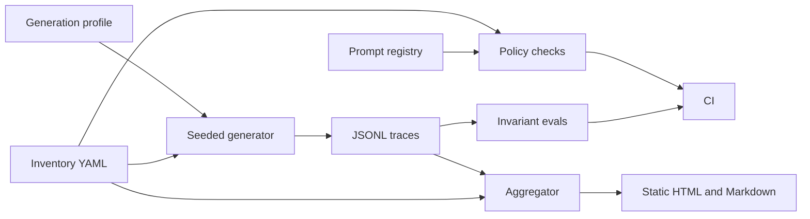

# agent-governance-cost-board

Policy checks, invariant evals, and a static cost board for a **simulated** fleet of 12 agents at the fictional Harborline Cooperative. The suite tests inventory rules, effect gates, and budget math. It does not test answer quality, and it does not call a model vendor.

## Problem and result

A fleet is hard to govern when ownership, human gates, and spend caps live in slides. This repo keeps them in YAML and checks them in CI, then rolls simulated JSONL traces into a board.

**Measured result (2026-10-17, package 0.1.0, Python 3.12.3):** simulated agent `refund-advisor` spent **3,319,160 micro-USD** on 2026-10-15, above its **1,200,000 micro-USD** daily cap (burn ratio 2.766). Command:

```bash
python3 -m governance_board report \
  --inventory inventory/fleet.yaml \
  --traces traces/fleet.jsonl \
  --out docs/example-board \
  --generated-on 2026-10-17
```

The same run wrote `docs/example-board/summary.json` (3 alerts, 2016 simulated events). The dollar figure uses the in-repo simulated rate card (5 micro-USD per input token, 15 per output token), marked [EST] and not a vendor price. Commit for this artifact: see [docs/example-board/MEASURED.md](docs/example-board/MEASURED.md).

## Demo

From the repo root, after `python3 -m pip install -e ".[dev]"`:

```bash
python3 -m governance_board demo
```

That checks the fleet policy, writes seeded traces, and opens a static board under `demo-out/`. Cost of the demo: **zero**. No network. No API key. `make demo` is the same command.

## Business case

Harborline is fictional. An illustrative model [EST]: 12 agents at $80 of model spend each per month is $960/month. Catching one runaway at about 3× a $40/day cap, one day after it starts instead of at the monthly invoice, avoids on the order of **$2,300** of overrun on that incident [EST]. The simulated board above uses a much smaller rate card so the demo stays obviously fake. Detail and assumptions: [docs/BUSINESS_CASE.md](docs/BUSINESS_CASE.md).

## Architecture



Inventory and prompts are the source of truth. The generator is a stand-in for a runtime. The aggregator only reads traces. The HTML file embeds its CSS and SVG and does not load a CDN. See [docs/architecture.md](docs/architecture.md).

## Results

Measured 2026-10-17 from the command in the first section. Package 0.1.0. Window 2026-10-04 through 2026-10-17, seed `20261017`, 12 runs per agent per day, 2016 events. Costs are **simulated**. Latency values are the simulated `latency_ms` field; percentiles are computed by the aggregator (linear interpolation). Means and percentiles below are rounded to 1 decimal from `docs/example-board/summary.json`. Totals are exact integers in micro-USD.

| Agent | Runs | Cost total (micro-USD) | Latency p95 (ms) | Alerts |
| --- | ---: | ---: | ---: | --- |
| intake-triage | 168 | 1,814,505 | 919.9 | — |
| claim-draft | 168 | 4,286,595 | 1,465.2 | — |
| kb-search | 168 | 1,306,175 | 670.8 | — |
| invoice-extract | 168 | 2,461,840 | 1,076.9 | — |
| meeting-notes | 168 | 2,500,185 | 1,278.2 | — |
| change-review | 168 | 2,586,270 | 1,238.3 | — |
| vendor-screener | 168 | 3,225,035 | 1,500.1 | — |
| onboarding-coach | 168 | 1,310,695 | 710.5 | — |
| refund-advisor | 168 | 8,436,435 | 1,761.2 | per-run cap, per-day cap |
| bulletin-draft | 168 | 4,437,160 | 5,895.4 | p95 latency SLO |
| shift-suggester | 168 | 1,653,445 | 961.2 | — |
| safety-checklist | 168 | 833,315 | 553.3 | — |

Fleet total: **34,851,655 micro-USD** ($34.8517 at the simulated rate) across 14 days.

Policy on `inventory/fleet.yaml` with `prompts/registry.yaml` and `--today 2026-10-17`: **PASS, 0 violations**. The violating fixture exits non-zero (5 violations on this date). Eval suite: pass (3 cases, 0 breaches). `eval-regression`: fail (3 breaches on one bad event), which is the expected red gate.

Pytest on 2026-10-17, Python 3.12.3, pytest 9.1.1, command `python3 -m pytest`: **22 passed**, total coverage **91.55%** (floor 80%).

## Use cases, governance and business strategy

### Client-style use cases

Fictional Harborline Cooperative. No real client.

| Use case | Status | Problem | Who approves | Gated effects | How this repo handles it |
| --- | --- | --- | --- | --- | --- |
| Governance board for a 12-agent fleet | Implemented | Owners, tiers, caps, and spend are scattered | Fleet governor owns the policy file; a human queue owns external effects | `update_claim_file`, `send_vendor_decision`, `write_ledger_note`, `update_schedule` | `inventory/fleet.yaml`, `python3 -m governance_board policy`, seeded traces, `docs/example-board/` |
| Vendor-risk intake for a new AI tool | Design only | A new tool shows up with no owner, data class, or cap | Procurement lead would accept the intake; security would accept the tier | Any effect the new tool could take | Not built. Discovery questions in `docs/DISCOVERY.md` say which fields the intake form would add |
| Incident review board | Design only | After a spike, people reconstruct the timeline from chat | Incident lead would close the review | The effect that ran during the incident | The cost-spike runbook is implemented; a multi-party review board is not |

### Personal use cases

| Use case | Status | Problem | Who approves | Gated effects | How this repo handles it |
| --- | --- | --- | --- | --- | --- |
| Personal AI subscription and cost tracker | Design only | Several subscriptions, no per-use view | The account holder | None in this repo | Not built. The fleet board is the shape such a tracker could copy |
| Personal automation inventory with kill switches | Design only | Scripts keep running after you stop wanting them | The account holder | Whatever the script can still call | The kill-switch field and CLI exist for the fictional fleet. A personal inventory file is not included |

### Design-only vs implemented

| Piece | Status |
| --- | --- |
| Inventory YAML and JSON Schema | Implemented |
| Policy-as-code CLI, plus a fixture that must fail CI | Implemented |
| Seeded JSONL generator, aggregator, static HTML and Markdown | Implemented |
| Invariant evals and a forced regression that must fail | Implemented |
| Kill switch and versioned prompt rollback | Implemented |
| NIST AI RMF and EU AI Act mapping | Implemented as an educational note, not a certification |
| SSO / RBAC | Design only |
| Live telemetry (OpenTelemetry, Grafana) | Design only |
| Alert delivery (page, ticket, chat) | Design only |
| Export of audit evidence into a GRC tool | Design only |
| Vendor-risk intake, incident review board, personal trackers | Design only |

### Governance checklist

| Control | Where it lives |
| --- | --- |
| Inventory, tier rubric, caps, owners | `inventory/fleet.yaml`, `src/governance_board/schema/inventory.schema.json`, `docs/RISK_RUBRIC.md` |
| Human approval | Policy rule `high_risk_human_gate`; eval invariant `no_unapproved_external_action` |
| Traceability | JSONL traces, `docs/example-board/summary.json`, prompt registry |
| Risks | [docs/RISKS.md](docs/RISKS.md) |
| Costs | [docs/COST.md](docs/COST.md) |
| Incident and rollback | [docs/RUNBOOK.md](docs/RUNBOOK.md), `kill-switch`, `rollback` |
| Secret scan and CI | `python3 -m governance_board secretscan`, `.github/workflows/ci.yml` |

**Not covered yet:** SSO/RBAC, live telemetry, alert delivery, GRC export, legal review, answer-quality scoring, real provider traffic.

### Business strategy

**Business problem.** Teams ship agents faster than they name an owner, a cap, and a human for the effects that leave the system.

**ROI model [EST].** See [docs/BUSINESS_CASE.md](docs/BUSINESS_CASE.md). The only measured money figure in this repo is the simulated micro-USD board, not a customer saving.

**Scope and phased rollout.** [docs/SCOPE.md](docs/SCOPE.md). This repo is phase 0: shadow data, local gates, no production runtime.

**Success metrics.** [docs/METRICS.md](docs/METRICS.md).

**Deployment Strategist conversation.** Start with discovery: who owns the effect, what data it touches, and what a bad day costs. Run the board in shadow (inventory plus traces, nothing blocked). Turn the gate on for the high tier first. The fleet governor owns `inventory/*.yaml`. The agent owner owns the prompt version and the budget numbers. A named human owns each external effect. This repo records those answers. It does not pick the org chart.

## Decisions

- [0001 — Inventory as YAML with JSON Schema](docs/adr/0001-inventory-yaml.md)
- [0002 — Policy as code in CI](docs/adr/0002-policy-as-code.md)
- [0003 — Static HTML, no CDN](docs/adr/0003-static-html.md)
- [0004 — Invariant evals, not trajectories](docs/adr/0004-invariant-evals.md)
- [0005 — Simulated micro-USD rate card](docs/adr/0005-simulated-rate.md)
- [0006 — Educational NIST and EU mapping](docs/adr/0006-educational-mapping.md)
- [0007 — Kill switch and prompt rollback](docs/adr/0007-kill-switch-rollback.md)

## Security and known limits

Configuration is environment variables only. `.env.example` is a template. `.env` is gitignored. The real HTTP provider stays off unless `GOVERNANCE_REAL_PROVIDER_ENABLED=1`, and CI does not set that flag. Tests block `socket.connect`.

### What this does NOT do

- It does not certify NIST AI RMF, the EU AI Act, ISO 42001, or any other framework.
- It does not give legal advice.
- It does not authenticate users or implement RBAC.
- It does not ship, page, or open tickets.
- It does not call a paid model API in CI or in the default demo.
- It does not score whether an answer is good.
- It does not prove production use. Every trace in the repo is synthetic.
- It does not preserve YAML comments when the kill-switch or rollback command rewrites a file.

## How to reproduce

Cost: **zero** by default. No key. No network in tests or in the demo.

`make` targets, and the same steps without make:

| Make | Plain command |
| --- | --- |
| `make setup` | `python3 -m pip install -e ".[dev]"` |
| `make lint` | `python3 -m ruff check . && python3 -m ruff format --check . && python3 -m mypy` |
| `make test` | `python3 -m pytest` |
| `make policy` | `python3 -m governance_board policy --inventory inventory/fleet.yaml --prompts prompts/registry.yaml --today 2026-10-17` |
| `make eval` | `python3 -m governance_board eval` |
| `make eval-regression` | `python3 -m governance_board eval-regression` (this **exits non-zero** on purpose) |
| `make generate` | `python3 -m governance_board generate-traces --inventory inventory/fleet.yaml --profile traces/generation.yaml --out traces/fleet.jsonl` |
| `make report` | `python3 -m governance_board report --inventory inventory/fleet.yaml --traces traces/fleet.jsonl --out docs/example-board --generated-on 2026-10-17` |
| `make demo` | `python3 -m governance_board demo` |
| `make secretscan` | `python3 -m governance_board secretscan` |

The violating inventory must fail:

```bash
python3 -m governance_board policy \
  --inventory inventory/violating.yaml \
  --prompts prompts/registry.yaml \
  --today 2026-10-17
```

CI runs lint, mypy, pytest (coverage floor 80%), the secret scan, the fleet policy, the violating-inventory failure, the eval gate, and the forced eval regression. See `.github/workflows/ci.yml`.

## Next steps

1. Point the aggregator at traces exported from a real runtime, still in shadow, still with the real provider off in CI.
2. Decide who is allowed to edit the inventory (the RBAC design in `docs/SCOPE.md`).
3. Deliver alerts somewhere a human already looks. This repo only writes the report.
4. Add an answer-quality eval only after the effect and cost gates stay green.

## Docs

| Doc | What it is |
| --- | --- |
| [docs/HOW_IT_WORKS.md](docs/HOW_IT_WORKS.md) | Walkthrough in rioplatense Spanish |
| [docs/architecture.md](docs/architecture.md) | Components and trace schema |
| [docs/BUSINESS_CASE.md](docs/BUSINESS_CASE.md) | ROI model [EST] |
| [docs/DISCOVERY.md](docs/DISCOVERY.md) | Ten discovery questions |
| [docs/SCOPE.md](docs/SCOPE.md) | Phases, assumptions, exit criteria |
| [docs/RISKS.md](docs/RISKS.md) | Risk matrix and educational control map |
| [docs/RISK_RUBRIC.md](docs/RISK_RUBRIC.md) | Low / medium / high rubric |
| [docs/METRICS.md](docs/METRICS.md) | What we measure |
| [docs/COST.md](docs/COST.md) | Simulated cost table |
| [docs/RUNBOOK.md](docs/RUNBOOK.md) | Cost-spike incident |
| [docs/ADAPT_TO_A_REAL_CLIENT.md](docs/ADAPT_TO_A_REAL_CLIENT.md) | What to replace |
| [docs/PROVENANCE.md](docs/PROVENANCE.md) | What was reused |
| [docs/example-board/](docs/example-board/) | Generated HTML, Markdown, summary |
| [SECURITY.md](SECURITY.md) | Reporting and secrets |
| [CHANGELOG.md](CHANGELOG.md) | Release notes |
